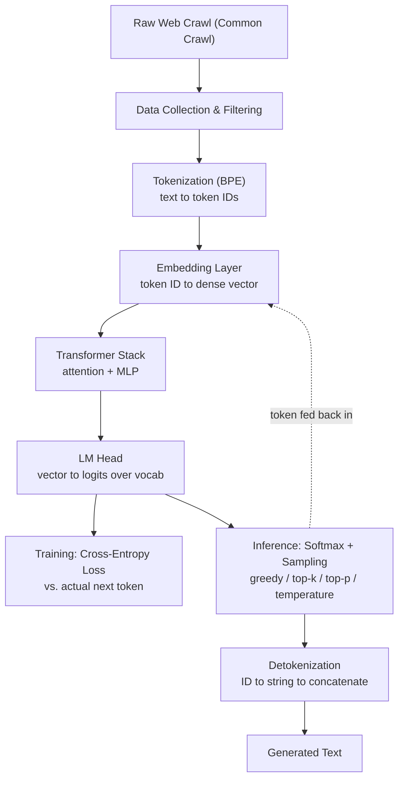

# Large Language Models

## List of Sources

1. [JJ] Lectures by Justin Johnson for 498 fall 2019.
2. [Géron2023] Hands-On Machine Learning with Scikit-Learn, Keras, and TensorFlow (3rd ed.) by Aurélien Géron
3. [ChatGPT] ChatGPT
4. [karpathy\_zero2hero] <https://github.com/karpathy/nn-zero-to-hero>

# Large Language Models

Knowledge (leads to good guessing abilities) vs. understanding.

## Terminology

- LUI - Language User Interface
- AI-Complete \textcolor{red}{COMPLETE, find a command for using complete as here} No mathematical rigour in the definition of this concept.

## Pipeline Overview

High-level view of the full pipeline, from raw web data to generated text. See [[data_preparation_and_tokenization]] for a higher-resolution version of the tokenization/detokenization portion, and [[architecture]] for the embedding/transformer/LM-head internals.

## Various - Rearrange Later

- [[data_preparation_and_tokenization]]
- [[inference_techniques]]
- [[training_and_adaptation]]
- [[architecture]]
- [[text_evaluation_metrics]]
- [[evaluation_paradigms]]
- [[agentic_workflows]]
- [[practical_engineering_concepts]]
