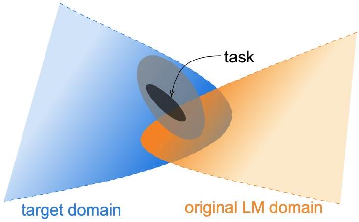
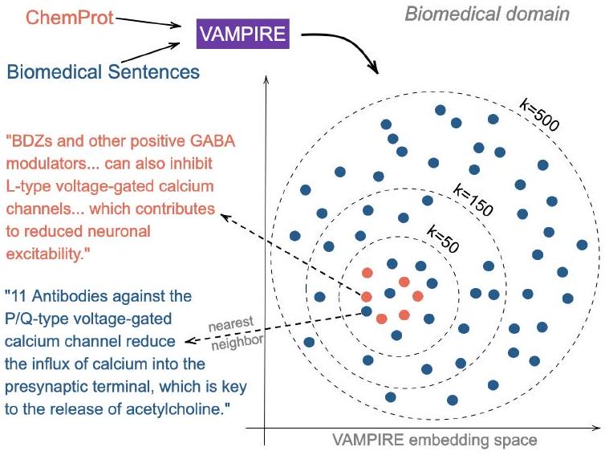

\title{
Don't Stop Pretraining: Adapt Language Models to Domains and Tasks
}

\author{
Suchin Gururangan ${ }^{\dagger}$ Ana Marasović ${ }^{\dagger ◇}$ Swabha Swayamdipta ${ }^{\dagger}$ Kyle Lo ${ }^{\dagger}$ Iz Beltagy ${ }^{\dagger}$ Doug Downey ${ }^{\dagger}$ Noah A. Smith ${ }^{\dagger ◇}$ \\ ${ }^{\dagger}$ Allen Institute for Artificial Intelligence, Seattle, WA, USA \\ ${ }^{\diamond}$ Paul G. Allen School of Computer Science \& Engineering, University of Washington, Seattle, WA, USA \\ \{suching, anam, swabhas, kylel, beltagy, dougd, noah\}@allenai.org
}

\begin{abstract}
Language models pretrained on text from a wide variety of sources form the foundation of today's NLP. In light of the success of these broad-coverage models, we investigate whether it is still helpful to tailor a pretrained model to the domain of a target task. We present a study across four domains (biomedical and computer science publications, news, and reviews) and eight classification tasks, showing that a second phase of pretraining indomain (domain-adaptive pretraining) leads to performance gains, under both high- and low-resource settings. Moreover, adapting to the task's unlabeled data (task-adaptive pretraining) improves performance even after domain-adaptive pretraining. Finally, we show that adapting to a task corpus augmented using simple data selection strategies is an effective alternative, especially when resources for domain-adaptive pretraining might be unavailable. Overall, we consistently find that multiphase adaptive pretraining offers large gains in task performance.
\end{abstract}

# 1 Introduction

Today's pretrained language models are trained on massive, heterogeneous corpora (Raffel et al., 2019; Yang et al., 2019). For instance, RoBERTA (Liu et al., 2019) was trained on over 160 GB of uncompressed text, with sources ranging from Englishlanguage encyclopedic and news articles, to literary works and web content. Representations learned by such models achieve strong performance across many tasks with datasets of varying sizes drawn from a variety of sources (e.g., Wang et al., 2018, 2019). This leads us to ask whether a tasks textual domain-a term typically used to denote a distribution over language characterizing a given topic or genre (such as "science" or "mystery novels")-is still relevant. Do the latest large pretrained models work universally or is it still helpful to build

**Figure 1: An illustration of data distributions. Task data is comprised of an observable task distribution, usually non-randomly sampled from a wider distribution (light grey ellipsis) within an even larger target domain, which is not necessarily one of the domains included in the original LM pretraining domain - though overlap is possible. We explore the benefits of continued pretraining on data from the task distribution and the domain distribution.**

separate pretrained models for specific domains?
While some studies have shown the benefit of continued pretraining on domain-specific unlabeled data (e.g., Lee et al., 2019), these studies only consider a single domain at a time and use a language model that is pretrained on a smaller and less diverse corpus than the most recent language models. Moreover, it is not known how the benefit of continued pretraining may vary with factors like the amount of available labeled task data, or the proximity of the target domain to the original pretraining corpus (see Figure 1).

We address this question for one such highperforming model, RoBERTA (Liu et al., 2019) (§2). We consider four domains (biomedical and computer science publications, news, and reviews; §3) and eight classification tasks (two in each domain). For targets that are not already in-domain for ROBERTA, our experiments show that contin-
ued pretraining on the domain (which we refer to as domain-adaptive pretraining or DAPT) consistently improves performance on tasks from the target domain, in both high- and low-resource settings.

Above, we consider domains defined around genres and forums, but it is also possible to induce a domain from a given corpus used for a task, such as the one used in supervised training of a model. This raises the question of whether pretraining on a corpus more directly tied to the task can further improve performance. We study how domainadaptive pretraining compares to task-adaptive pretraining, or TAPT, on a smaller but directly taskrelevant corpus: the unlabeled task dataset (§4), drawn from the task distribution. Task-adaptive pretraining has been shown effective (Howard and Ruder, 2018), but is not typically used with the most recent models. We find that tapt provides a large performance boost for RoBERTA, with or without domain-adaptive pretraining.

Finally, we show that the benefits from taskadaptive pretraining increase when we have additional unlabeled data from the task distribution that has been manually curated by task designers or annotators. Inspired by this success, we propose ways to automatically select additional task-relevant unlabeled text, and show how this improves performance in certain low-resource cases (§5). On all tasks, our results using adaptive pretraining techniques are competitive with the state of the art.

In summary, our contributions include:
\begin{itemize}
\item[-] a thorough analysis of domain- and taskadaptive pretraining across four domains and eight tasks, spanning low- and high-resource settings;
\item[-] an investigation into the transferability of adapted LMs across domains and tasks; and
\item[-] a study highlighting the importance of pretraining on human-curated datasets, and a simple data selection strategy to automatically approach this performance.
\end{itemize}

Our code as well as pretrained models for multiple domains and tasks are publicly available. ${ }^{1}$

# 2 Background: Pretraining

Learning for most NLP research systems since 2018 consists of training in two stages. First, a neural language model (LM), often with millions of parameters, is trained on large unlabeled cor-

\footnotetext{
${ }^{1}$ https://github.com/allenai/ dont-stop-pretraining
}
pora. The word (or wordpiece; Wu et al. 2016) representations learned in the pretrained model are then reused in supervised training for a downstream task, with optional updates (fine-tuning) of the representations and network from the first stage.

One such pretrained LM is RoBERTA (Liu et al., 2019), which uses the same transformerbased architecture (Vaswani et al., 2017) as its predecessor, BERT (Devlin et al., 2019). It is trained with a masked language modeling objective (i.e., cross-entropy loss on predicting randomly masked tokens). The unlabeled pretraining corpus for ROBERTA contains over 160 GB of uncompressed raw text from different English-language corpora (see Appendix §A.1). RoBERTA attains better performance on an assortment of tasks than its predecessors, making it our baseline of choice.

Although RoBERTA's pretraining corpus is derived from multiple sources, it has not yet been established if these sources are diverse enough to generalize to most of the variation in the English language. In other words, we would like to understand what is out of RoBERTA's domain. Towards this end, we explore further adaptation by continued pretraining of this large LM into two categories of unlabeled data: (i) large corpora of domain-specific text (§3), and (ii) available unlabeled data associated with a given task (§4).

# 3 Domain-Adaptive Pretraining

Our approach to domain-adaptive pretraining (DAPT) is straightforward-we continue pretraining RoBERTA on a large corpus of unlabeled domain-specific text. The four domains we focus on are biomedical (BioMed) papers, computer science (CS) papers, newstext from RealNews, and Amazon reviews. We choose these domains because they have been popular in previous work, and datasets for text classification are available in each. Table 1 lists the specifics of the unlabeled datasets in all four domains, as well as ROBERTA's training corpus. ${ }^{1}$

## 3.1 Analyzing Domain Similarity

Before performing DAPT, we attempt to quantify the similarity of the target domain to ROBERTA's pretraining domain. We consider domain vocabularies containing the top 10K most frequent unigrams (excluding stopwords) in comparably sized

\footnotetext{
${ }^{1}$ For BioMed and CS, we used an internal version of S2ORC that contains papers that cannot be released due to copyright restrictions.
}

\begin{table}
\begin{tabular}[t]{|l|l|l|l|l|l|}
\hline Domain & Pretraining Corpus & \# Tokens & Size & $\mathcal{L}_{\text {Rob. }}$ & $\mathcal{L}_{\text {DAPT }}$ \\
\hline BioMed & 2.68M full-text papers from S2ORC (Lo et al., 2020) & 7.55B & 47GB & 1.32 & 0.99 \\
\hline CS & 2.22M full-text papers from S2ORC (Lo et al., 2020) & 8.10B & 48GB & 1.63 & 1.34 \\
\hline News & 11.90M articles from RealNews (Zellers et al., 2019) & 6.66B & 39GB & 1.08 & 1.16 \\
\hline Reviews & 24.75M Amazon reviews (He and McAuley, 2016) & 2.11B & 11GB & 2.10 & 1.93 \\
\hline ROBERTA (baseline) & see Appendix §A. 1 & N/A & 160 GB & ${ }^{\ddagger} 1.19$ & - \\
\hline
\end{tabular}

**Table 1: List of the domain-specific unlabeled datasets. In columns 5 and 6, we report RoBERTA's masked LM loss on 50K randomly sampled held-out documents from each domain before \(\left(\mathcal{L**_{\text {ROB. }}\right)\) and after \(\left(\mathcal{L}_{\text {DAPT }}\right)\) DAPT (lower implies a better fit on the sample). ‡ indicates that the masked LM loss is estimated on data sampled from sources similar to ROBERTA's pretraining corpus.}
\end{table}

\begin{table}
\begin{tabular}[t]{|l|l|l|l|l|l|}
\hline PT & 100.0 & 54.1 & 34.5 & 27.3 & 19.2 \\
\hline News & 54.1 & 100.0 & 40.0 & 24.9 & 17.3 \\
\hline Reviews & 34.5 & 40.0 & 100.0 & 18.3 & 12.7 \\
\hline BioMed & 27.3 & 24.9 & 18.3 & 100.0 & 21.4 \\
\hline CS & 19.2 & 17.3 & 12.7 & 21.4 & 100.0 \\
\hline & PT & News & Reviews & BioMed & CS \\
\hline
\end{tabular}

**Figure 2: Vocabulary overlap (\%) between domains. PT denotes a sample from sources similar to ROBERTA's pretraining corpus. Vocabularies for each domain are created by considering the top 10K most frequent words (excluding stopwords) in documents sampled from each domain.**
\end{table}
random samples of held-out documents in each domain's corpus. We use 50K held-out documents for each domain other than Reviews, and 150K held-out documents in Reviews, since they are much shorter. We also sample 50K documents from sources similar to ROBERTA's pretraining corpus (i.e., BookCorpus, Stories, Wikipedia, and RealNews) to construct the pretraining domain vocabulary, since the original pretraining corpus is not released. Figure 2 shows the vocabulary overlap across these samples. We observe that ROBERTA's pretraining domain has strong vocabulary overlap with News and Reviews, while CS and BioMed are far more dissimilar to the other domains. This simple analysis suggests the degree of benefit to be expected by adaptation of ROBERTA to different domains-the more dissimilar the domain, the higher the potential for dapt.

## 3.2 Experiments

Our LM adaptation follows the settings prescribed for training RoBERTA. We train RoBERTA on each domain for 12.5K steps, which amounts to single pass on each domain dataset, on a v3-8 TPU; see other details in Appendix B. This second phase of pretraining results in four domain-adapted LMs, one for each domain. We present the masked LM loss of RoBERTA on each domain before and after dapt in Table 1. We observe that masked LM loss decreases in all domains except News after dapt, where we observe a marginal increase. We discuss cross-domain masked LM loss in Appendix §E.

Under each domain, we consider two text classification tasks, as shown in Table 2. Our tasks represent both high- and low-resource ( $\leq 5$ K labeled training examples, and no additional unlabeled data) settings. For HyperPartisan, we use the data splits from Beltagy et al. (2020). For RCT, we represent all sentences in one long sequence for simultaneous prediction.

Baseline As our baseline, we use an off-the-shelf ROBERTA-base model and perform supervised fine-tuning of its parameters for each classification task. On average, ROBERTA is not drastically behind the state of the art (details in Appendix §A.2), and serves as a good baseline since it provides a single LM to adapt to different domains.

Classification Architecture Following standard practice (Devlin et al., 2019) we pass the final layer [CLS] token representation to a task-specific feedforward layer for prediction (see Table 14 in Appendix for more hyperparameter details).

Results Test results are shown under the dapt column of Table 3 (see Appendix §C for validation results). We observe that DAPT improves over RoBERTA in all domains. For BioMed, CS, and Reviews, we see consistent improve-

\begin{table}
\begin{tabular}[t]{|l|l|l|l|l|l|l|l|}
\hline Domain & Task & Label Type & Train (Lab.) & Train (Unl.) & Dev. & Test & Classes \\
\hline \multirow{2}{*}{BioMed} & ChemProt & relation classification & 4169 & - & 2427 & 3469 & 13 \\
\hline & ${ }^{\dagger}$ RCT & abstract sent. roles & 18040 & - & 30212 & 30135 & 5 \\
\hline \multirow{2}{*}{CS} & ACL-ARC & citation intent & 1688 & - & 114 & 139 & 6 \\
\hline & SciERC & relation classification & 3219 & - & 455 & 974 & 7 \\
\hline \multirow{2}{*}{News} & HyperPartisan & partisanship & 515 & 5000 & 65 & 65 & 2 \\
\hline & ${ }^{\dagger}$ AGNews & topic & 115000 & - & 5000 & 7600 & 4 \\
\hline \multirow{2}{*}{Reviews} & ${ }^{\dagger}$ Helpfulness & review helpfulness & 115251 & - & 5000 & 25000 & 2 \\
\hline & ${ }^{\dagger}$ IMDB & review sentiment & 20000 & 50000 & 5000 & 25000 & 2 \\
\hline
\end{tabular}

**Table 2: Specifications of the various target task datasets. † indicates high-resource settings. Sources: ChemProt (Kringelum et al., 2016), RCT (Dernoncourt and Lee, 2017), ACL-ARC (Jurgens et al., 2018), SciERC (Luan et al., 2018), HyperPartisan (Kiesel et al., 2019), AGNews (Zhang et al., 2015), Helpfulness (McAuley et al., 2015), IMDB (Maas et al., 2011).**
\end{table}

\begin{table}
\begin{tabular}[t]{|l|l|l|l|l|}
\hline Dom. & Task & RoBA. & DAPT & ¬DAPT \\
\hline \multirow{2}{*}{BM} & ChemProt & $81.9_{1.0}$ & $\mathbf{8 4 . 2}_{0.2}$ & $79.4_{1.3}$ \\
\hline & ${ }^{\dagger}$ RCT & $87.2_{0.1}$ & $\mathbf{8 7 . 6}_{0.1}$ & $86.9_{0.1}$ \\
\hline \multirow{2}{*}{CS} & ACL-ARC & $63.0_{5.8}$ & $\mathbf{7 5 . 4}_{2.5}$ & $66.4_{4.1}$ \\
\hline & SciERC & $77.3_{1.9}$ & $\mathbf{8 0 . 8}_{1.5}$ & $79.2_{0.9}$ \\
\hline \multirow{2}{*}{News} & HyP. & $86.6_{0.9}$ & $\mathbf{8 8 . 2}_{5.9}$ & $76.4_{4.9}$ \\
\hline & †AGNews & $\mathbf{9 3 . 9}_{0.2}$ & $\mathbf{9 3 . 9}_{0.2}$ & $93.5_{0.2}$ \\
\hline \multirow{2}{*}{Rev.} & ${ }^{\dagger}$ Helpful. & $65.1_{3.4}$ & $\mathbf{6 6 . 5}_{1.4}$ & $65.1_{2.8}$ \\
\hline & ${ }^{\dagger}$ IMDB & $95.0_{0.2}$ & $\mathbf{9 5 . 4}_{0.2}$ & $94.1_{0.4}$ \\
\hline
\end{tabular}

**Table 3: Comparison of RoBERTA (RoBa.) and DAPT to adaptation to an irrelevant domain ( $\neg$ DAPT). Reported results are test macro- $F_{1**$, except for ChemProt and RCT, for which we report micro- $F_{1}$, following Beltagy et al. (2019). We report averages across five random seeds, with standard deviations as subscripts. † indicates high-resource settings. Best task performance is boldfaced. See §3.3 for our choice of irrelevant domains.}
\end{table}
ments over RoBERTA, demonstrating the benefit of DAPT when the target domain is more distant from RoBERTA's source domain. The pattern is consistent across high- and low- resource settings. Although DAPT does not increase performance on AGNews, the benefit we observe in HyperPar-TISAN suggests that DAPT may be useful even for tasks that align more closely with RoBERTA's source domain.

## 3.3 Domain Relevance for DAPT

Additionally, we compare DAPT against a setting where for each task, we adapt the LM to a domain outside the domain of interest. This controls for the case in which the improvements over RoBERTA might be attributed simply to exposure to more data, regardless of the domain. In this setting, for News, we use a CS LM; for Reviews, a BioMed LM; for CS, a News LM; for BioMed, a Reviews LM. We use the vocabulary overlap statistics in Figure 2 to guide these choices.

Our results are shown in Table 3, where the last column (¬DAPT) corresponds to this setting. For each task, DAPT significantly outperforms adapting to an irrelevant domain, suggesting the importance of pretraining on domain-relevant data. Furthermore, we generally observe that ¬DAPT results in worse performance than even ROBERTA on end-tasks. Taken together, these results indicate that in most settings, exposure to more data without considering domain relevance is detrimental to end-task performance. However, there are two tasks (SciERC and ACL-ARC) in which ¬DAPT marginally improves performance over RoBERTA. This may suggest that in some cases, continued pretraining on any additional data is useful, as noted in Baevski et al. (2019).

## 3.4 Domain Overlap

Our analysis of DAPT is based on prior intuitions about how task data is assigned to specific domains. For instance, to perform dapt for Helpfulness, we only adapt to Amazon reviews, but not to any RealNews articles. However, the gradations in Figure 2 suggest that the boundaries between domains are in some sense fuzzy; for example, 40\% of unigrams are shared between Reviews and News. As further indication of this overlap, we also qualitatively identify documents that overlap cross-domain: in Table 4, we showcase reviews and RealNews articles that are similar to these reviews (other examples can be found in Appendix §D). In fact, we find that adapting RoBERTA to

\begin{table}
\begin{tabular}[t]{|l|l|}
\hline IMDB review & RealNews article \\
\hline \begin{tabular}[t]{l}
The Shop Around the Corner is one of the great films from director \\
Ernst Lubitsch . In addition to the talents of James Stewart and Margaret Sullavan , it's filled with a terrific cast of top character actors such as Frank Morgan and Felix Bressart. [...] The makers of You've Got Mail claim their film to be a remake , but that's just nothing but a lot of inflated self praise. Anyway, if you have an affection for romantic comedies of the 1940 's, you'll find The Shop Around the Corner to be nothing short of wonderful. Just as good with repeat viewings.
\end{tabular} & [...] Three great festive films... The Shop Around the Corner (1940) Delightful Comedy by Ernst Lubitsch stars James Stewart and Margaret Sullavan falling in love at Christmas. Remade as Youve Got Mail. [...] \\
\hline Helpfulness review & RealNews article \\
\hline Simply the Best! I've owned countless Droids and iPhones, but this one destroys them all. Samsung really nailed it with this one, extremely fast , very pocketable, gorgeous display , exceptional battery life , good audio quality, perfect GPS \& WiFi performance, transparent status bar, battery percentage, ability to turn off soft key lights, superb camera for a smartphone and more! [...] & Were living in a world with a new Samsung. [...] more on battery life later [...] Exposure is usually spot on and focusing is very fast. [...] The design, display, camera and performance are all best in class, and the phone feels smaller than it looks. [...] \\
\hline
\end{tabular}

**Table 4: Examples that illustrate how some domains might have overlaps with others, leading to unexpected positive transfer. We highlight expressions in the reviews that are also found in the RealNews articles.**
\end{table}

News not as harmful to its performance on ReVIEWS tasks (DAPT on News achieves $65.5_{2.3}$ on Helpfulness and $95.0_{0.1}$ on IMDB).

Although this analysis is by no means comprehensive, it indicates that the factors that give rise to observable domain differences are likely not mutually exclusive. It is possible that pretraining beyond conventional domain boundaries could result in more effective DAPT; we leave this investigation to future work. In general, the provenance of data, including the processes by which corpora are curated, must be kept in mind when designing pretraining procedures and creating new benchmarks that test out-of-domain generalization abilities.

# 4 Task-Adaptive Pretraining

Datasets curated to capture specific tasks of interest tend to cover only a subset of the text available within the broader domain. For example, the ChemProt dataset for extracting relations between chemicals and proteins focuses on abstracts of recently-published, high-impact articles from hand-selected PubMed categories (Krallinger et al., 2017, 2015). We hypothesize that such cases where the task data is a narrowly-defined subset of the broader domain, pretraining on the task dataset itself or data relevant to the task may be helpful.

Task-adaptive pretraining (TAPT) refers to pretraining on the unlabeled training set for a given task; prior work has shown its effectiveness (e.g. Howard and Ruder, 2018). Compared to domainadaptive pretraining (DAPT; §3), the task-adaptive approach strikes a different trade-off: it uses a far smaller pretraining corpus, but one that is much more task-relevant (under the assumption that the training set represents aspects of the task well). This makes TAPT much less expensive to run than DAPT, and as we show in our experiments, the performance of TAPT is often competitive with that of DAPT.

## 4.1 Experiments

Similar to dapt, task-adaptive pretraining consists of a second phase of pretraining RoBERTA, but only on the available task-specific training data. In contrast to dapt, which we train for 12.5K steps, we perform tapt for 100 epochs. We artificially augment each dataset by randomly masking different words (using the masking probability of 0.15) across epochs. As in our DAPT experiments, we pass the final layer [CLS] token representation to a task-specific feedforward layer for classification (see Table 14 in Appendix for more hyperparameter details).

Our results are shown in the TAPT column of Table 5. TAPT consistently improves the ROBERTA baseline for all tasks across domains. Even on the news domain, which was part of ROBERTA pretraining corpus, TAPT improves over RoBERTA, showcasing the advantage of task adaptation. Particularly remarkable are the relative differences between TAPT and DAPT. DAPT is more resource intensive (see Table 9 in §5.3), but tapt manages to match its performance in some of the tasks, such as Scierc. In RCT, HyperPartisan, AGNews, Helpfulness, and IMDB, the results even exceed those of dapt, highlighting the efficacy of this cheaper adaptation technique.

\begin{table}
\begin{tabular}[t]{|l|l|l|l|l|l|}
\hline \multirow[b]{2}{*}{Domain} & \multirow[b]{2}{*}{Task} & \multirow[b]{2}{*}{ROBERTA} & \multicolumn{3}{|c|}{Additional Pretraining Phases} \\
\hline & & & DAPT & TAPT & DAPT + TAPT \\
\hline \multirow{2}{*}{BioMed} & ChemProt & $81.9_{1.0}$ & $84.2_{0.2}$ & $82.6_{0.4}$ & $\mathbf{8 4 . 4}_{0.4}$ \\
\hline & ${ }^{\dagger}$ RCT & $87.2_{0.1}$ & $87.6_{0.1}$ & $87.7_{0.1}$ & $\mathbf{8 7 . 8}_{0.1}$ \\
\hline \multirow{2}{*}{CS} & ACL-ARC & $63.0_{5.8}$ & $75.4_{2.5}$ & $67.4_{1.8}$ & $\mathbf{7 5 . 6}_{3.8}$ \\
\hline & Scierc & $77.3_{1.9}$ & $80.8_{1.5}$ & $79.3_{1.5}$ & $\mathbf{8 1 . 3}_{1.8}$ \\
\hline \multirow{2}{*}{News} & HyperPartisan & $86.6_{0.9}$ & $88.2_{5.9}$ & $\mathbf{9 0 . 4}_{5.2}$ & $90.0_{6.6}$ \\
\hline & ${ }^{\dagger}$ AGNews & $93.9_{0.2}$ & $93.9_{0.2}$ & $94.5_{0.1}$ & $\mathbf{9 4 . 6}_{0.1}$ \\
\hline \multirow{2}{*}{Reviews} & ${ }^{\dagger}$ Helpfulness & $65.1_{3.4}$ & $66.5_{1.4}$ & $68.5_{1.9}$ & $\mathbf{6 8 . 7}_{1.8}$ \\
\hline & ${ }^{\dagger}$ IMDB & $95.0_{0.2}$ & $95.4_{0.1}$ & $95.5_{0.1}$ & $\mathbf{9 5 . 6}_{0.1}$ \\
\hline
\end{tabular}

**Table 5: Results on different phases of adaptive pretraining compared to the baseline ROBERTA (col. 1). Our approaches are dapt (col. 2, §3), tapt (col. 3, §4), and a combination of both (col. 4). Reported results follow the same format as Table 3. State-of-the-art results we can compare to: ChemProt (84.6), RCT (92.9), ACL-ARC (71.0), Scierc (81.8), HyperPartisan (94.8), AGNews (95.5), IMDB (96.2); references in §A.2.**
\end{table}

\begin{table}
\begin{tabular}[t]{|l|l|l|l|l|l|}
\hline BioMed & RCT & ChemProt & CS & ACL-ARC & SciERC \\
\hline TAPT & $87.7_{0.1}$ & $82.6_{0.5}$ & TAPT & $67.4_{1.8}$ & $79.3_{1.5}$ \\
\hline Transfer-TAPT & \(87.1_{0.4}(\downarrow 0.6)\) & \(80.4_{0.6}(\downarrow 2.2)\) & Transfer-TAPT & \(64.1_{2.7}(\downarrow 3.3)\) & \(79.1_{2.5}(\downarrow 0.2)\) \\
\hline News & HyperPartisan & AGNews & Reviews & Helpfulness & IMDB \\
\hline TAPT & 89.99.5 & $94.5_{0.1}$ & TAPT & $68.5_{1.9}$ & $95.7_{0.1}$ \\
\hline Transfer-TAPT & \(82.2_{7.7}(\downarrow 7.7)\) & \(93.9_{0.2}(\downarrow 0.6)\) & Transfer-TAPT & \(65.0_{2.6}(\downarrow 3.5)\) & \(95.0_{0.1}(\downarrow 0.7)\) \\
\hline
\end{tabular}

**Table 6: Though TAPT is effective (Table 5), it is harmful when applied across tasks. These findings illustrate differences in task distributions within a domain.**
\end{table}

Combined Dapt and tapt We investigate the effect of using both adaptation techniques together. We begin with RoBERTA and apply DAPT then TAPT under this setting. The three phases of pretraining add up to make this the most computationally expensive of all our settings (see Table 9). As expected, combined domain- and task-adaptive pretraining achieves the best performance on all tasks (Table 5). ${ }^{2}$

Overall, our results show that DAPT followed by TAPT achieves the best of both worlds of domain and task awareness, yielding the best performance. While we speculate that TAPT followed by DAPT would be susceptible to catastrophic forgetting of the task-relevant corpus (Yogatama et al., 2019), alternate methods of combining the procedures may result in better downstream performance. Future work may explore pretraining with a more sophisticated curriculum of domain and task distributions.

\footnotetext{
${ }^{2}$ Results on HyperPartisan match those of tapt, within a standard deviation arising from the five seeds.
}

Cross-Task Transfer We complete the comparison between DAPT and TAPT by exploring whether adapting to one task transfers to other tasks in the same domain. For instance, we further pretrain the LM using the RCT unlabeled data, fine-tune it with the ChemProt labeled data, and observe the effect. We refer to this setting as Transfer-TAPT. Our results for tasks in all four domains are shown in Table 6. We see that tapt optimizes for single task performance, to the detriment of cross-task transfer. These results demonstrate that data distributions of tasks within a given domain might differ. Further, this could also explain why adapting only to a broad domain is not sufficient, and why TAPT after DAPT is effective.

# 5 Augmenting Training Data for Task-Adaptive Pretraining

In §4, we continued pretraining the LM for task adaptation using only the training data for a supervised task. Inspired by the success of TAPT, we next investigate another setting where a larger pool of unlabeled data from the task distribution exists,

\begin{table}
\begin{tabular}[t]{|l|l|l|l|}
\hline Pretraining & BioMed RCT-500 & News HyP. & Reviews IMDB ${ }^{\dagger}$ \\
\hline TAPT & $79.8_{1.4}$ & $90.4_{5.2}$ & $95.5_{0.1}$ \\
\hline DAPT + TAPT & $83.0_{0.3}$ & $90.0_{6.6}$ & $95.6_{0.1}$ \\
\hline Curated-TAPT & $83.4_{0.3}$ & 89.99.5 & $95.7_{0.1}$ \\
\hline DAPT + Curated-TAPT & $\mathbf{8 3 . 8}_{0.5}$ & $\mathbf{9 2 . 1}_{3.6}$ & $\mathbf{9 5 . 8}_{0.1}$ \\
\hline
\end{tabular}

**Table 7: Mean test set macro- $F_{1**$ (for HyP. and IMDB) and micro- $F_{1}$ (for RCT-500), with CuratedTAPT across five random seeds, with standard deviations as subscripts. † indicates high-resource settings.}
\end{table}
typically curated by humans.
We explore two scenarios. First, for three tasks (RCT, HyperPartisan, and IMDB) we use this larger pool of unlabeled data from an available human-curated corpus (§5.1). Next, we explore retrieving related unlabeled data for TAPT, from a large unlabeled in-domain corpus, for tasks where extra human-curated data is unavailable (§5.2).

## 5.1 Human Curated-tapt

Dataset creation often involves collection of a large unlabeled corpus from known sources. This corpus is then downsampled to collect annotations, based on the annotation budget. The larger unlabeled corpus is thus expected to have a similar distribution to the task's training data. Moreover, it is usually available. We explore the role of such corpora in task-adaptive pretraining.

Data We simulate a low-resource setting RCT500, by downsampling the training data of the RCT dataset to 500 examples (out of 180 K available), and treat the rest of the training data as unlabeled. The HyperPartisan shared task (Kiesel et al., 2019) has two tracks: low- and high-resource. We use 5K documents from the high-resource setting as Curated-TAPT unlabeled data and the original lowresource training documents for task fine-tuning. For IMDB, we use the extra unlabeled data manually curated by task annotators, drawn from the same distribution as the labeled data (Maas et al., 2011).

Results We compare Curated-TAPT to TAPT and dapt + tapt in Table 7. Curated-tapt further improves our prior results from §4 across all three datasets. Applying Curated-TAPT after adapting to the domain results in the largest boost in performance on all tasks; in HyperPartisan, dapt + Curated-tapt is within standard deviation of Curated-tapt. Moreover, curated-tapt achieves

**Figure 3: An illustration of automated data selection (§5.2). We map unlabeled ChemProt and 1M BioMed sentences to a shared vector space using the VAMPIRE model trained on these sentences. Then, for each ChemProt sentence, we identify $k$ nearest neighbors, from the BioMed domain.**

\begin{table}
\begin{tabular}[t]{|l|l|l|l|}
\hline \multirow[b]{2}{*}{Pretraining} & \multicolumn{2}{|c|}{BioMed} & CS \\
\hline & ChemProt & RCT-500 & ACL-ARC \\
\hline ROBERTA & $81.9_{1.0}$ & $79.3_{0.6}$ & $63.0_{5.8}$ \\
\hline TAPT & $82.6_{0.4}$ & $79.8_{1.4}$ & $67.4_{1.8}$ \\
\hline RAND-TAPT & $81.9_{0.6}$ & $80.6_{0.4}$ & $69.7_{3.4}$ \\
\hline 50nn-tapt & $83.3_{0.7}$ & $80.8_{0.6}$ & $70.7_{2.8}$ \\
\hline 150NN-TAPT & $83.2_{0.6}$ & $81.2_{0.8}$ & $73.3_{2.7}$ \\
\hline 500nn-tapt & $83.3_{0.7}$ & $81.7_{0.4}$ & $\mathbf{7 5 . 5}_{1.9}$ \\
\hline DAPT & $\mathbf{8 4 . 2}_{0.2}$ & $\mathbf{8 2 . 5}_{0.5}$ & $75.4_{2.5}$ \\
\hline
\end{tabular}

**Table 8: Mean test set micro- $F_{1**$ (for ChemProt and RCT) and macro- $F_{1}$ (for ACL-ARC), across five random seeds, with standard deviations as subscripts, comparing RAND-TAPT (with 50 candidates) and $k$ NNTAPT selection. Neighbors of the task data are selected from the domain data.}
\end{table}
95\% of the performance of DAPT + TAPT with the fully labeled RCT corpus (Table 5) with only 0.3\% of the labeled data. These results suggest that curating large amounts of data from the task distribution is extremely beneficial to end-task performance. We recommend that task designers release a large pool of unlabeled task data for their tasks to aid model adaptation through pretraining.

## 5.2 Automated Data Selection for TAPT

Consider a low-resource scenario without access to large amounts of unlabeled data to adequately benefit from TAPT, as well as absence of computational resources necessary for DAPT (see Table 9 for details of computational requirements for different pretraining phases). We propose simple unsuper-
vised methods to retrieve unlabeled text that aligns with the task distribution, from a large in-domain corpus. Our approach finds task-relevant data from the domain by embedding text from both the task and domain in a shared space, then selects candidates from the domain based on queries using the task data. Importantly, the embedding method must be lightweight enough to embed possibly millions of sentences in a reasonable time.

Given these constraints, we employ VAMPIRE (Gururangan et al., 2019; Figure 3), a lightweight bag-of-words language model. We pretrain VAM-PIRE on a large deduplicated ${ }^{3}$ sample of the domain (1M sentences) to obtain embeddings of the text from both the task and domain sample. We then select $k$ candidates of each task sentence from the domain sample, in embeddings space. Candidates are selected (i) via nearest neighbors selection ( $k$ NN-TAPT) ${ }^{4}$, or (ii) randomly (RAND-TAPT). We continue pretraining RoBERTA on this augmented corpus with both the task data (as in TAPT) as well as the selected candidate pool.

Results Results in Table 8 show that $k$ NN-tapt outperforms TAPT for all cases. RAND-TAPT is generally worse than $k$ NN-TAPT, but within a standard deviation arising from 5 seeds for RCT and ACL-ARC. As we increase $k, k$ NN-TAPT performance steadily increases, and approaches that of dapt. Appendix F shows examples of nearest neighbors of task data. Future work might consider a closer study of $k$ NN-TAPT, more sophisticated data selection methods, and the tradeoff between the diversity and task relevance of selected examples.

## 5.3 Computational Requirements

The computational requirements for all our adaptation techniques on RCT-500 in the BioMed domain in Table 9. TAPT is nearly 60 times faster to train than DAPT on a single v3-8 TPU and storage requirements for DAPT on this task are 5.8M times that of tapt. Our best setting of DAPT + TAPT amounts to three phases of pretraining, and at first glance appears to be very expensive. However, once the LM has been adapted to a broad domain, it can be reused for multiple tasks within that domain, with only a single additional TAPT phase per task. While Curated-tapt tends to achieve the best cost-

\footnotetext{
${ }^{3}$ We deduplicated this set to limit computation, since different sentences can share neighbors.
${ }^{4}$ We use a flat search index with cosine similarity between embeddings with the FAISS (Johnson et al., 2019) library.
}

\begin{table}
\begin{tabular}[t]{|l|l|l|l|l|}
\hline Pretraining & Steps & Docs. & Storage & $F_{1}$ \\
\hline RoBERTA & - & - & - & $79.3_{0.6}$ \\
\hline TAPT & 0.2K & 500 & 80KB & $79.8_{1.4}$ \\
\hline 50nn-tapt & 1.1K & 24 K & 3MB & $80.8_{0.6}$ \\
\hline 150nn-tapt & 3.2K & 66K & 8MB & $81.2_{0.8}$ \\
\hline 500nn-tapt & 9.0K & 185K & 24MB & $81.7_{0.4}$ \\
\hline Curated-tapt & 8.8K & 180K & 27MB & $\mathbf{8 3 . 4}_{0.3}$ \\
\hline DAPT & 12.5 K & 25M & 47GB & $82.5_{0.5}$ \\
\hline DAPT + TAPT & 12.6K & 25M & 47GB & $83.0_{0.3}$ \\
\hline
\end{tabular}

**Table 9: Computational requirements for adapting to the RCT-500 task, comparing dapt (§3) and the various tapt modifications described in §4 and §5.**
\end{table}
benefit ratio in this comparison, one must also take into account the cost of curating large in-domain data. Automatic methods such as $k$ NN-TAPT are much cheaper than DAPT.

# 6 Related Work

Transfer learning for domain adaptation Prior work has shown the benefit of continued pretraining in domain (Alsentzer et al., 2019; Chakrabarty et al., 2019; Lee et al., 2019). ${ }^{5}$ We have contributed further investigation of the effects of a shift between a large, diverse pretraining corpus and target domain on task performance. Other studies (e.g., Huang et al., 2019) have trained language models (LMs) in their domain of interest, from scratch. In contrast, our work explores multiple domains, and is arguably more cost effective, since we continue pretraining an already powerful LM.

Task-adaptive pretraining Continued pretraining of a LM on the unlabeled data of a given task (TAPT) has been show to be beneficial for endtask performance (e.g. in Howard and Ruder, 2018; Phang et al., 2018; Sun et al., 2019). In the presence of domain shift between train and test data distributions of the same task, domain-adaptive pretraining (DAPT) is sometimes used to describe what we term TAPT (Logeswaran et al., 2019; Han and Eisenstein, 2019). Related approaches include language modeling as an auxiliary objective to task classifier fine-tuning (Chronopoulou et al., 2019; Radford et al., 2018) or consider simple syntactic structure of the input while adapting to task-specific

\footnotetext{
${ }^{5}$ In contrast, Peters et al. (2019) find that the JensenShannon divergence on term distributions between BERT's pretraining corpora and each MultiNLI domain (Williams et al., 2018) does not predict its performance, though this might be an isolated finding specific to the MultiNLI dataset.
}

\begin{table}
\begin{tabular}[t]{|l|l|l|l|}
\hline \multirow{2}{*}{} & \multicolumn{3}{|c|}{Training Data} \\
\hline & Domain (Unlabeled) & Task (Unlabeled) & Task (Labeled) \\
\hline ROBERTA & & & ✓ \\
\hline DAPT & ✓ & & ✓ \\
\hline TAPT & & ✓ & ✓ \\
\hline DAPT + TAPT & ✓ & ✓ & ✓ \\
\hline $k \mathrm{NN}$-TAPT & (Subset) & ✓ & ✓ \\
\hline Curated-TAPT & & (Extra) & ✓ \\
\hline
\end{tabular}

**Table 10: Summary of strategies for multi-phase pretraining explored in this paper.**
\end{table}
data (Swayamdipta et al., 2019). We compare DAPT and TAPT as well as their interplay with respect to dataset size for continued pretraining (hence, expense of more rounds of pretraining), relevance to a data sample of a given task, and transferability to other tasks and datasets. See Table 11 in Appendix §A for a summary of multi-phase pretraining strategies from related work.

Data selection for transfer learning Selecting data for transfer learning has been explored in NLP (Moore and Lewis, 2010; Ruder and Plank, 2017; Zhang et al., 2019, among others). Dai et al. (2019) focus on identifying the most suitable corpus to pretrain a LM from scratch, for a single task: NER, whereas we select relevant examples for various tasks in §5.2. Concurrent to our work, Aharoni and Goldberg (2020) propose data selection methods for NMT based on cosine similarity in embedding space, using DistilBERT (Sanh et al., 2019) for efficiency. In contrast, we use VAMPIRE, and focus on augmenting TAPT data for text classification tasks. Khandelwal et al. (2020) introduced $k$ NN-LMs that allows easy domain adaptation of pretrained LMs by simply adding a datastore per domain and no further training; an alternative to integrate domain information in an LM. Our study of human-curated data §5.1 is related to focused crawling (Chakrabarti et al., 1999) for collection of suitable data, especially with LM reliance (Remus and Biemann, 2016).

What is a domain? Despite the popularity of domain adaptation techniques, most research and practice seems to use an intuitive understanding of domains. A small body of work has attempted to address this question (Lee, 2001; Eisenstein et al., 2014; van der Wees et al., 2015; Plank, 2016; Ruder et al., 2016, among others). For instance, Aharoni and Goldberg (2020) define domains by implicit clusters of sentence representations in pretrained LMs. Our results show that dapt and tapt complement each other, which suggests a spectra of domains defined around tasks at various levels of granularity (e.g., Amazon reviews for a specific product, all Amazon reviews, all reviews on the web, the web).

# 7 Conclusion

We investigate several variations for adapting pretrained LMs to domains and tasks within those domains, summarized in Table 10. Our experiments reveal that even a model of hundreds of millions of parameters struggles to encode the complexity of a single textual domain, let alone all of language. We show that pretraining the model towards a specific task or small corpus can provide significant benefits. Our findings suggest it may be valuable to complement work on ever-larger LMs with parallel efforts to identify and use domain- and taskrelevant corpora to specialize models. While our results demonstrate how these approaches can improve RoBERTA, a powerful LM, the approaches we studied are general enough to be applied to any pretrained LM. Our work points to numerous future directions, such as better data selection for TAPT, efficient adaptation large pretrained language models to distant domains, and building reusable language models after adaptation.

# Acknowledgments

The authors thank Dallas Card, Mark Neumann, Nelson Liu, Eric Wallace, members of the AllenNLP team, and anonymous reviewers for helpful feedback, and Arman Cohan for providing data. This research was supported in part by the Office of Naval Research under the MURI grant N00014-18-1-2670. TPU machines for conducting experiments were provided by Google.

# References

Roee Aharoni and Yoav Goldberg. 2020. Unsupervised domain clusters in pretrained language models. In ACL. To appear.

Emily Alsentzer, John Murphy, William Boag, WeiHung Weng, Di Jindi, Tristan Naumann, and Matthew McDermott. 2019. Publicly available clinical BERT embeddings. In Proceedings of the 2nd Clinical Natural Language Processing Workshop.

Alexei Baevski, Sergey Edunov, Yinhan Liu, Luke Zettlemoyer, and Michael Auli. 2019. Cloze-driven pretraining of self-attention networks. In EMNLP.

Iz Beltagy, Kyle Lo, and Arman Cohan. 2019. SciBERT: A pretrained language model for scientific text. In EMNLP.

Iz Beltagy, Matthew E. Peters, and Arman Cohan. 2020. Longformer: The long-document transformer. arXiv:2004.05150.

Soumen Chakrabarti, Martin van den Berg, and Byron Dom. 1999. Focused Crawling: A New Approach to Topic-Specific Web Resource Discovery. Comput. Networks, 31:1623-1640.

Tuhin Chakrabarty, Christopher Hidey, and Kathy McKeown. 2019. IMHO fine-tuning improves claim detection. In NAACL.

Ciprian Chelba, Tomas Mikolov, Michael Schuster, Qi Ge, Thorsten Brants, Phillipp Koehn, and Tony Robinson. 2014. One billion word benchmark for measuring progress in statistical language modeling. In INTERSPEECH.

Alexandra Chronopoulou, Christos Baziotis, and Alexandros Potamianos. 2019. An embarrassingly simple approach for transfer learning from pretrained language models. In NAACL.

Arman Cohan, Iz Beltagy, Daniel King, Bhavana Dalvi, and Dan Weld. 2019. Pretrained language models for sequential sentence classification. In EMNLP.

Xiang Dai, Sarvnaz Karimi, Ben Hachey, and Cecile Paris. 2019. Using similarity measures to select pretraining data for NER. In NAACL.

Franck Dernoncourt and Ji Young Lee. 2017. Pubmed 200k RCT: a dataset for sequential sentence classification in medical abstracts. In IJCNLP.

Jacob Devlin, Ming-Wei Chang, Kenton Lee, and Kristina Toutanova. 2019. BERT: Pre-training of deep bidirectional transformers for language understanding. In NAACL.

Jesse Dodge, Suchin Gururangan, Dallas Card, Roy Schwartz, and Noah A Smith. 2019. Show your work: Improved reporting of experimental results. In EMNLP.

Jacob Eisenstein, Brendan O'connor, Noah A. Smith, and Eric P. Xing. 2014. Diffusion of lexical change in social media. PloS ONE.

Matt Gardner, Joel Grus, Mark Neumann, Oyvind Tafjord, Pradeep Dasigi, Nelson F. Liu, Matthew Peters, Michael Schmitz, and Luke Zettlemoyer. 2018. AllenNLP: A deep semantic natural language processing platform. In NLP-OSS.

Aaron Gokaslan and Vanya Cohen. 2019. OpenWebText Corpus.

Suchin Gururangan, Tam Dang, Dallas Card, and Noah A. Smith. 2019. Variational pretraining for semi-supervised text classification. In ACL.

Xiaochuang Han and Jacob Eisenstein. 2019. Unsupervised domain adaptation of contextualized embeddings for sequence labeling. In EMNLP.

Ruining He and Julian McAuley. 2016. Ups and downs: Modeling the visual evolution of fashion trends with one-class collaborative filtering. In $W W W$.

Matthew Honnibal and Ines Montani. 2017. spaCy 2: Natural language understanding with Bloom embeddings, convolutional neural networks and incremental parsing.

Jeremy Howard and Sebastian Ruder. 2018. Universal language model fine-tuning for text classification. In ACL.

Kexin Huang, Jaan Altosaar, and Rajesh Ranganath. 2019. ClinicalBERT: Modeling clinical notes and predicting hospital readmission. arXiv:1904.05342.

Jeff Johnson, Matthijs Douze, and Hervé Jégou. 2019. Billion-scale similarity search with gpus. IEEE Transactions on Big Data.

David Jurgens, Srijan Kumar, Raine Hoover, Daniel A. McFarland, and Dan Jurafsky. 2018. Measuring the evolution of a scientific field through citation frames. TACL.

Urvashi Khandelwal, Omer Levy, Dan Jurafsky, Luke Zettlemoyer, and Mike Lewis. 2020. Generalization through memorization: Nearest neighbor language models. In ICLR. To appear.

Johannes Kiesel, Maria Mestre, Rishabh Shukla, Emmanuel Vincent, Payam Adineh, David Corney, Benno Stein, and Martin Potthast. 2019. SemEval2019 Task 4: Hyperpartisan news detection. In SemEval.

Diederik P Kingma and Jimmy Ba. 2015. Adam: A method for stochastic optimization. In ICLR.

Martin Krallinger, Obdulia Rabal, Saber Ahmad Akhondi, Martín Pérez Pérez, Jésús López Santamaría, Gael Pérez Rodríguez, Georgios Tsatsaronis, Ander Intxaurrondo, José Antonio Baso López, Umesh Nandal, E. M. van Buel, A. Poorna Chandrasekhar, Marleen Rodenburg, Astrid Lægreid, Marius A. Doornenbal, Julen Oyarzábal, Anália Loureno, and Alfonso Valencia. 2017. Overview of the biocreative vi chemical-protein interaction track. In Proceedings of the BioCreative VI Workshop.

Martin Krallinger, Obdulia Rabal, Florian Leitner, Miguel Vazquez, David Salgado, Zhiyong Lu, Robert Leaman, Yanan Lu, Donghong Ji, Daniel M Lowe, et al. 2015. The chemdner corpus of chemicals and drugs and its annotation principles. Journal of cheminformatics, 7(1):S2.

Jens Kringelum, Sonny Kim Kjærulff, Søren Brunak, Ole Lund, Tudor I. Oprea, and Olivier Taboureau. 2016. ChemProt-3.0: a global chemical biology diseases mapping. In Database.

David YW Lee. 2001. Genres, registers, text types, domains and styles: Clarifying the concepts and navigating a path through the BNC jungle. Language Learning \& Technology.

Jinhyuk Lee, Wonjin Yoon, Sungdong Kim, Donghyeon Kim, Sunkyu Kim, Chan Ho So, and Jaewoo Kang. 2019. BioBERT: A pre-trained biomedical language representation model for biomedical text mining. Bioinformatics.

Yinhan Liu, Myle Ott, Naman Goyal, Jingfei Du, Mandar Joshi, Danqi Chen, Omer Levy, Mike Lewis, Luke Zettlemoyer, and Veselin Stoyanov. 2019. RoBERTa: A robustly optimized BERT pretraining approach. arXiv:1907.11692.

Kyle Lo, Lucy Lu Wang, Mark Neumann, Rodney Kinney, and Daniel S. Weld. 2020. S2ORC: The Semantic Scholar Open Research Corpus. In ACL. To appear.

Lajanugen Logeswaran, Ming-Wei Chang, Kenton Lee, Kristina Toutanova, Jacob Devlin, and Honglak Lee. 2019. Zero-shot entity linking by reading entity descriptions. In ACL.

Yi Luan, Luheng He, Mari Ostendorf, and Hannaneh Hajishirzi. 2018. Multi-task identification of entities, relations, and coreference for scientific knowledge graph construction. In EMNLP.

Andrew L. Maas, Raymond E. Daly, Peter T. Pham, Dan Huang, Andrew Y. Ng, and Christopher Potts. 2011. Learning word vectors for sentiment analysis. In ACL.

Julian McAuley, Christopher Targett, Qinfeng Shi, and Anton Van Den Hengel. 2015. Image-based recommendations on styles and substitutes. In ACM SIGIR.

Arindam Mitra, Pratyay Banerjee, Kuntal Kumar Pal, Swaroop Ranjan Mishra, and Chitta Baral. 2020. Exploring ways to incorporate additional knowledge to improve natural language commonsense question answering. arXiv:1909.08855v3.

Robert C. Moore and William Lewis. 2010. Intelligent selection of language model training data. In ACL.

Sebastian Nagel. 2016. CC-NEWS.
Mark Neumann, Daniel King, Iz Beltagy, and Waleed Ammar. 2019. Scispacy: Fast and robust models for biomedical natural language processing. Proceedings of the 18th BioNLP Workshop and Shared Task.

Matthew E. Peters, Sebastian Ruder, and Noah A. Smith. 2019. To tune or not to tune? Adapting pretrained representations to diverse tasks. In RepLANLP.

Jason Phang, Thibault Févry, and Samuel R. Bowman. 2018. Sentence encoders on STILTs: Supplementary training on intermediate labeled-data tasks. arXiv:1811.01088.

Barbara Plank. 2016. What to do about non-standard (or non-canonical) language in NLP. In KONVENS.

Alec Radford, Karthik Narasimhan, Tim Salimans, and Ilya Sutskever. 2018. Improving language understanding by generative pre-training.

Colin Raffel, Noam Shazeer, Adam Kaleo Roberts, Katherine Lee, Sharan Narang, Michael Matena, Yanqi Zhou, Wei Li, and Peter J. Liu. 2019. Exploring the limits of transfer learning with a unified text-to-text transformer. arXiv:1910.10683.

Steffen Remus and Chris Biemann. 2016. DomainSpecific Corpus Expansion with Focused Webcrawling. In LREC.

Sebastian Ruder, Parsa Ghaffari, and John G. Breslin. 2016. Towards a continuous modeling of natural language domains. In Workshop on Uphill Battles in Language Processing: Scaling Early Achievements to Robust Methods.

Sebastian Ruder and Barbara Plank. 2017. Learning to select data for transfer learning with Bayesian optimization. In EMNLP.

Victor Sanh, Lysandre Debut, Julien Chaumond, and Thomas Wolf. 2019. DistilBERT, a distilled version of BERT: smaller, faster, cheaper and lighter. In EMC2 @ NeurIPS.

Chi Sun, Xipeng Qiu, Yige Xu, and Xuanjing Huang. 2019. How to fine-tune BERT for text classification? In CCL.

Swabha Swayamdipta, Matthew Peters, Brendan Roof, Chris Dyer, and Noah A Smith. 2019. Shallow syntax in deep water. arXiv:1908.11047.

Tan Thongtan and Tanasanee Phienthrakul. 2019. Sentiment classification using document embeddings trained with cosine similarity. In ACL SRW.

Trieu H. Trinh and Quoc V. Le. 2018. A simple method for commonsense reasoning. arXiv:1806.02847.

Ashish Vaswani, Noam Shazeer, Niki Parmar, Jakob Uszkoreit, Llion Jones, Aidan N Gomez, Łukasz Kaiser, and Illia Polosukhin. 2017. Attention is all you need. In NeurIPS.

Alex Wang, Yada Pruksachatkun, Nikita Nangia, Amanpreet Singh, Julian Michael, Felix Hill, Omer Levy, and Samuel R. Bowman. 2019. SuperGLUE: A stickier benchmark for general-purpose language understanding systems. In NeurIPS.

Alex Wang, Amanpreet Singh, Julian Michael, Felix Hill, Omer Levy, and Samuel Bowman. 2018. GLUE: A multi-task benchmark and analysis platform for natural language understanding. In BlackboxNLP @ EMNLP.

Marlies van der Wees, Arianna Bisazza, Wouter Weerkamp, and Christof Monz. 2015. What's in a domain? Analyzing genre and topic differences in statistical machine translation. In ACL.

Adina Williams, Nikita Nangia, and Samuel Bowman. 2018. A broad-coverage challenge corpus for sentence understanding through inference. In NAACL.

Thomas Wolf, Lysandre Debut, Victor Sanh, Julien Chaumond, Clement Delangue, Anthony Moi, Pierric Cistac, Tim Rault, Rmi Louf, Morgan Funtowicz, and Jamie Brew. 2019. HuggingFace's Transformers: State-of-the-art natural language processing. arXiv:1910.03771.

Yonghui Wu, Mike Schuster, Zhifeng Chen, Quoc V Le, Mohammad Norouzi, Wolfgang Macherey, Maxim Krikun, Yuan Cao, Qin Gao, Klaus Macherey, et al. 2016. Google's neural machine translation system: Bridging the gap between human and machine translation.

Hu Xu, Bing Liu, Lei Shu, and Philip Yu. 2019a. BERT post-training for review reading comprehension and aspect-based sentiment analysis. In NAACL.

Hu Xu, Bing Liu, Lei Shu, and Philip S. Yu. 2019b. Review conversational reading comprehension. arXiv:1902.00821v2.

Zhilin Yang, Zihang Dai, Yiming Yang, Jaime G. Carbonell, Ruslan Salakhutdinov, and Quoc V. Le. 2019. XLNet: Generalized autoregressive pretraining for language understanding. In NeurIPS.

Dani Yogatama, Cyprien de Masson d'Autume, Jerome Connor, Tomás Kociský, Mike Chrzanowski, Lingpeng Kong, Angeliki Lazaridou, Wang Ling, Lei Yu, Chris Dyer, and Phil Blunsom. 2019. Learning and evaluating general linguistic intelligence.

Rowan Zellers, Ari Holtzman, Hannah Rashkin, Yonatan Bisk, Ali Farhadi, Franziska Roesner, and Yejin Choi. 2019. Defending against neural fake news. In NeurIPS.

Xiang Zhang, Junbo Jake Zhao, and Yann LeCun. 2015. Character-level convolutional networks for text classification. In NeurIPS.

Xuan Zhang, Pamela Shapiro, Gaurav Kumar, Paul Mc-Namee, Marine Carpuat, and Kevin Duh. 2019. Curriculum learning for domain adaptation in neural machine translation. In NAACL.

Yukun Zhu, Ryan Kiros, Richard S. Zemel, Ruslan Salakhutdinov, Raquel Urtasun, Antonio Torralba, and Sanja Fidler. 2015. Aligning books and movies: Towards story-like visual explanations by watching movies and reading books. In ICCV.

# Appendix Overview

In this supplementary material, we provide: (i) additional information for producing the results in the paper, and (ii) results that we could not fit into the main body of the paper.

Appendix A. A tabular overview of related work described in Section §6, a description of the corpus used to train RoBERTA in Liu et al. (2019), and references to the state of the art on our tasks.

Appendix B. Details about the data preprocessing, training, and implementation of domain- and taskadaptive pretraining.

Appendix C. Development set results.
Appendix D. Examples of domain overlap.
Appendix E. The cross-domain masked LM loss and reproducibility challenges.

Appendix F. Illustration of our data selection method and examples of nearest neighbours.

# A Related Work

Table 11 shows which of the strategies for continued pretraining have already been explored in the prior work from the Related Work (§6). As evident from the table, our work compares various strategies as well as their interplay using a pretrained language model trained on a much more heterogeneous pretraining corpus.

# A. 1 RoBERTA's Pretraining Corpus

ROBERTA was trained on data from BookCorPUS (Zhu et al., 2015), ${ }^{6}$ Wikipedia, ${ }^{7}$ a portion of the CCNews dataset (Nagel, 2016), ${ }^{8}$ OpenWebText corpus of Web content extracted from URLs shared on Reddit (Gokaslan and Cohen, 2019), ${ }^{9}$ and a subset of CommonCrawl that it is said to resemble the "story-like" style of Winograd schemas (STORIES; Trinh and Le, 2018). ${ }^{10}$

# A. 2 State of the Art

In this section, we specify the models achieving state of the art on our tasks. See the caption of

\footnotetext{
${ }^{6}$ https://github.com/soskek/bookcorpus
${ }^{7}$ https://github.com/google-research/ bert
${ }^{8}$ https://github.com/fhamborg/ news-please
${ }^{9}$ https://github.com/jcpeterson/ openwebtext
${ }^{10}$ https://github.com/tensorflow/models/ tree/master/research/lm_commonsense
}
Table 5 for the reported performance of these models. For ACL-ARC, that is SciBERT (Beltagy et al., 2019), a BERT-base model for trained from scratch on scientific text. For ChemProt and SciERC, that is S2ORC-BERT (Lo et al., 2020), a similar model to SciBERT. For AGNews and IMDB, XLNet-large, a much larger model. For RCT, Cohan et al. (2019). For HyperPartisan, Longformer, a modified Transformer language model for long documents (Beltagy et al., 2020). Thongtan and Phienthrakul (2019) report a higher number (97.42) on IMDB, but they train their word vectors on the test set. Our baseline establishes the first benchmark for the Helpfulness dataset.

# B Experimental Setup

Preprocessing for DAPT The unlabeled corpus in each domain was pre-processed prior to language model training. Abstracts and body paragraphs from biomedical and computer science articles were used after sentence splitting using scispaCy (Neumann et al., 2019). We used summaries and full text of each news article, and the entire body of review from Amazon reviews. For both news and reviews, we perform sentence splitting using spaCy (Honnibal and Montani, 2017).

Training details for DAPT We train ROBERTA on each domain for 12.5K steps. We focused on matching all the domain dataset sizes (see Table 1) such that each domain is exposed to the same amount of data as for 12.5K steps it is trained for. Amazon reviews contain more documents, but each is shorter. We used an effective batch size of 2048 through gradient accumulation, as recommended in Liu et al. (2019). See Table 13 for more hyperparameter details.

Training details for TAPT We use the same pretraining hyperparameters as DAPT, but we artificially augmented each dataset for TAPT by randomly masking different tokens across epochs, using the masking probability of 0.15 . Each dataset was trained for 100 epochs. For tasks with less than 5K examples, we used a batch size of 256 through gradient accumulation. See Table 13 for more hyperparameter details.

Optimization We used the Adam optimizer (Kingma and Ba, 2015), a linear learning rate scheduler with 6\% warm-up, a maximum learning rate of 0.0005. When we used a batch size of 256, we

\begin{table}
\begin{tabular}[t]{|l|l|l|l|l|l|l|l|l|}
\hline & DAPT Domains (if applicable) & Tasks & Model & DAPT & TAPT & DAPT + TAPT & $k \mathrm{NN}$ TAPT & CuratedTAPT \\
\hline This Paper & biomedical \& computer science papers, news, reviews & 8 classification tasks & ROBERTA & ✓ & ✓ & ✓ & ✓ & ✓ \\
\hline Aharoni and Goldberg (2020) & - & NMT & DistilBERT + Transformer NMT & - & - & - & similar & - \\
\hline Alsentzer et al. (2019) & clinical text & NER, NLI, de-identification & (Bio)BERT & ✓ & - & - & - & - \\
\hline Chakrabarty et al. (2019) & opinionated claims from Reddit & claim detection & ULMFIT & ✓ & ✓ & - & - & - \\
\hline Chronopoulou et al. (2019) & - & 5 classification tasks & ULMFIT ${ }^{\dagger}$ & - & similar & - & - & - \\
\hline Han and Eisenstein (2019) & - & NER in historical texts & ELMo, BERT & - & ✓ & - & - & - \\
\hline Howard and Ruder (2018) & - & 6 classification tasks & ULMFIT & - & ✓ & - & - & - \\
\hline Khandelwal et al. (2020) & - & language modeling & Transformer LM & - & - & - & similar & - \\
\hline Lee et al. (2019) & biomedical papers & NER, QA, relation extraction & BERT & ✓ & - & - & - & - \\
\hline Logeswaran et al. (2019) & - & zero-shot entity linking in Wikia & BERT & - & ✓ & - & - & - \\
\hline Mitra et al. (2020) & - & commonsense QA & BERT & - & ✓ & - & - & - \\
\hline Phang et al. (2018) & - & GLUE tasks & ELMo, BERT, GPT & - & ✓ & - & - & - \\
\hline Radford et al. (2018) & - & NLI, QA, similarity, classification & GPT & - & similar & - & - & - \\
\hline Sun et al. (2019) & sentiment, question, topic & 7 classification tasks & BERT & ✓ & ✓ & - & - & - \\
\hline Swayamdipta et al. (2019) & - & NER, parsing, classification & ELMo & - & similar & - & - & - \\
\hline Xu et al. (2019a) & reviews & RC, aspect extract., sentiment classification & BERT & ✓ & ✓ & ✓ & - & - \\
\hline Xu et al. (2019b) & restaurant reviews, laptop reviews & conversational RC & BERT & ✓ & ✓ & - & - & - \\
\hline
\end{tabular}

**Table 11: Overview of prior work across strategies for continued pre-training summarized in Table 10. ULMFIT is pretrained on English Wikipedia; ULMFIT ${ **^{\dagger}$ on English tweets; ELMo on the 1B WordBenchmark (newswire; Chelba et al., 2014); GPT on BookCorpus; BERT on English Wikipedia and BookCorpus. In comparison to these pretraining corpora, RoBERTA's pretraining corpus is substantially more diverse (see Appendix §A.1).}
\end{table}
used a maximum learning rate of 0.0001 , as recommended in Liu et al. (2019). We observe a high variance in performance between random seeds when fine-tuning RoBERTA to HyperPartisan, because the dataset is extremely small. To produce final results on this task, we discard and resample degenerate seeds. We display the full hyperparameter settings in Table 13.

Implementation Our LM implementation uses the HuggingFace transformers library (Wolf et al., 2019) ${ }^{11}$ and PyTorch XLA for TPU compatibility. ${ }^{12}$ Each adaptive pretraining exper-

\footnotetext{
${ }^{11}$ https://github.com/huggingface/ transformers
${ }^{12}$ https://github.com/pytorch/xla
}
iment was performed on a single v3-8 TPU from Google Cloud. ${ }^{13}$ For the text classification tasks, we used AllenNLP (Gardner et al., 2018). Following standard practice (Devlin et al., 2019) we pass the final layer [CLS] token representation to a task-specific feedforward layer for prediction.

# C Development Set Results

Adhering to the standards suggested by Dodge et al. (2019) for replication, we report our development set results in Tables 15, 17, and 18.

\footnotetext{
${ }^{13}$ http://github.com/allenai/ tpu-pretrain
}

# D Analysis of Domain Overlap

In Table 20 we display additional examples that highlight the overlap between IMDB reviews and RealNews articles, relevant for analysis in §3.1.

# E Analysis of Cross-Domain Masked LM Loss

In Section §3.2, we provide RoBERTA's masked LM loss before and after dapt. We display crossdomain masked-LM loss in Table 12, where we evaluate masked LM loss on text samples in other domains after performing DAPT.

We observe that the cross-domain masked-LM loss mostly follows our intuition and insights from the paper, i.e. RoBERTA's pretraining corpus and News are closer, and BioMed to CS (relative to other domains). However, our analysis in §3.1 illustrates that Reviews and News also have some similarities. This is supported with the loss of RoBERTA that is adapted to News, calculated on a sample of Reviews. However, RoBERTA that is adapted to Reviews results in the highest loss for a News sample. This is the case for all domains. One of the properties that distinguishes Reviews from all other domains is that its documents are significantly shorter. In general, we find that cross-DAPT masked-LM loss can in some cases be a noisy predictor of domain similarity.

# F $k$-Nearest Neighbors Data Selection

In Table 21, we display nearest neighbor documents in the BioMed domain identified by our selection method, on the RCT dataset.

\begin{table}
\begin{tabular}[t]{|l|l|l|l|l|l|}
\hline \multirow{2}{*}{} & \multicolumn{5}{|c|}{Data Sample Unseen During Dapt} \\
\hline & PT & BioMed & CS & News & Reviews \\
\hline \multirow{5}{*}{\begin{tabular}[t]{l}
RoBERTA \\
Reviews
\end{tabular}} & 1.19 & 1.32 & 1.63 & 1.08 & 2.10 \\
\hline & 1.63 & 0.99 & 1.63 & 1.69 & 2.59 \\
\hline & 1.82 & 1.43 & 1.34 & 1.92 & 2.78 \\
\hline & 1.33 & 1.50 & 1.82 & 1.16 & 2.16 \\
\hline & 2.07 & 2.23 & 2.44 & 2.27 & 1.93 \\
\hline
\end{tabular}

**Table 12: RoBERTA's (row 1) and domain-adapted RoBERTA's (rows 2-5) masked LM loss on randomly sampled held-out documents from each domain (lower implies a better fit). PT denotes a sample from sources similar to ROBERTA's pretraining corpus. The lowest masked LM for each domain sample is boldfaced.**
\end{table}

\begin{tabular}[t]{|l|l|}
\hline Computing Infrastructure & Google Cloud v3-8 TPU \\
\hline Model implementations & https://github.com/allenai/tpu_pretrain \\
\hline
\end{tabular}

\begin{table}
\begin{tabular}[t]{|l|l|}
\hline Hyperparameter & Assignment \\
\hline number of steps & 100 epochs (TAPT) or 12.5 K steps (DAPT) \\
\hline batch size & 256 or 2058 \\
\hline maximum learning rate & 0.0001 or 0.0005 \\
\hline learning rate optimizer & Adam \\
\hline Adam epsilon & 1e-6 \\
\hline Adam beta weights & 0.9, 0.98 \\
\hline learning rate scheduler & None or warmup linear \\
\hline Weight decay & 0.01 \\
\hline Warmup proportion & 0.06 \\
\hline learning rate decay & linear \\
\hline
\end{tabular}

**Table 13: Hyperparameters for domain- and task- adaptive pretraining.**
\end{table}

\begin{table}
\begin{tabular}[t]{|l|l|l|}
\hline Computing Infrastructure & \multicolumn{2}{|c|}{Quadro RTX 8000 GPU} \\
\hline Model implementation & \multicolumn{2}{|l|}{https://github.com/allenai/dont-stop-pretraining} \\
\hline \multirow{9}{*}{} & Hyperparameter & Assignment \\
\hline & number of epochs & 3 or 10 \\
\hline & patience & 3 \\
\hline & batch size & 16 \\
\hline & learning rate & 2e-5 \\
\hline & dropout & 0.1 \\
\hline & feedforward layer & 1 \\
\hline & feedforward nonlinearity & tanh \\
\hline & classification layer & 1 \\
\hline
\end{tabular}

**Table 14: Hyperparameters for RoBERTA text classifier.**
\end{table}

\begin{table}
\begin{tabular}[t]{|l|l|l|l|l|l|}
\hline \multirow[b]{2}{*}{Domain} & \multirow[b]{2}{*}{Task} & \multirow[b]{2}{*}{RoBERTA} & \multicolumn{3}{|c|}{Additional Pretraining Phases} \\
\hline & & & DAPT & TAPT & DAPT + TAPT \\
\hline \multirow{2}{*}{BioMed} & ChemProt & $83.2_{1.4}$ & $\mathbf{8 4 . 1}_{0.5}$ & $83.0_{0.6}$ & $\mathbf{8 4 . 1}_{0.5}$ \\
\hline & ${ }^{\dagger}$ RCT & $88.1_{0.05}$ & $\mathbf{8 8 . 5}_{0.1}$ & $88.3_{0.1}$ & $\mathbf{8 8 . 5}_{0.1}$ \\
\hline \multirow{2}{*}{CS} & ACL-ARC & $71.3_{2.8}$ & $73.2_{1.5}$ & $73.2_{3.6}$ & $\mathbf{7 8 . 6}_{2.9}$ \\
\hline & Scierc & $83.8_{1.1}$ & $\mathbf{8 8 . 4}_{1.7}$ & $85.9_{0.8}$ & $88.0_{1.3}$ \\
\hline \multirow{2}{*}{News} & HyperPartisan & $84.0_{1.5}$ & $79.1_{3.5}$ & $\mathbf{8 2 . 7}_{3.3}$ & $80.8_{2.3}$ \\
\hline & ${ }^{\dagger}$ AGNews & $94.3_{0.1}$ & $94.3_{0.1}$ & $94.7_{0.1}$ & $\mathbf{9 4 . 9}_{0.1}$ \\
\hline \multirow{2}{*}{Reviews} & ${ }^{\dagger}$ Helpfulness & $65.5_{3.4}$ & $66.5_{1.4}$ & $69.2_{2.4}$ & $\mathbf{6 9 . 4}_{2.1}$ \\
\hline & ${ }^{\dagger}$ IMDB & $94.8_{0.1}$ & $95.3_{0.1}$ & $95.4_{0.1}$ & $\mathbf{9 5 . 7}_{0.2}$ \\
\hline
\end{tabular}

**Table 15: Results on different phases of adaptive pretraining compared to the baseline RoBERTA (col. 1). Our approaches are dapt (col. 2, §3), tapt (col. 3, §4), and a combination of both (col. 4). Reported results are development macro- $F_{1**$, except for ChemProt and RCT, for which we report micro- $F_{1}$, following Beltagy et al. (2019). We report averages across five random seeds, with standard deviations as subscripts. † indicates high-resource settings. Best task performance is boldfaced. State-of-the-art results we can compare to: ChemProt (84.6), RCT (92.9), ACL-ARC (71.0), Scierc (81.8), HyperPartisan (94.8), AGNews (95.5), IMDB (96.2); references in §A.2.}
\end{table}

\begin{table}
\begin{tabular}[t]{|l|l|l|l|l|}
\hline Dom. & Task & RoB. & DAPT & ¬DAPT \\
\hline \multirow{2}{*}{BM} & ChemProt & $83.2_{1.4}$ & $\mathbf{8 4 . 1}_{0.5}$ & $80.9_{0.5}$ \\
\hline & ${ }^{\dagger}$ RCT & $88.1_{0.0}$ & $\mathbf{8 8 . 5}_{0.1}$ & $87.9_{0.1}$ \\
\hline \multirow{2}{*}{CS} & ACL-ARC & $71.3_{2.8}$ & $\mathbf{7 3 . 2}_{1.5}$ & $68.1_{5.4}$ \\
\hline & SciERC & $83.8_{1.1}$ & $\mathbf{8 8 . 4}_{1.7}$ & $83.9_{0.9}$ \\
\hline \multirow{2}{*}{News} & HyP. & $\mathbf{8 4 . 0}_{1.5}$ & $79.1_{3.5}$ & $71.6_{4.6}$ \\
\hline & ${ }^{\dagger}$ AGNews & $\mathbf{9 4 . 3}_{0.1}$ & $\mathbf{9 4 . 3}_{0.1}$ & $94.0_{0.1}$ \\
\hline \multirow{2}{*}{Rev.} & ${ }^{\dagger}$ Helpful. & $65.5_{3.4}$ & $\mathbf{6 6 . 5}_{1.4}$ & $65.5_{3.0}$ \\
\hline & ${ }^{\dagger}$ IMDB & $94.8_{0.1}$ & $\mathbf{9 5 . 3}_{0.1}$ & $93.8_{0.2}$ \\
\hline
\end{tabular}

**Table 16: Development comparison of RoBERTA (RoBa.) and DAPT to adaptation to an irrelevant domain (¬ dapt). See §3.3 for our choice of irrelevant domains. Reported results follow the same format as Table 5.**
\end{table}

\begin{table}
\begin{tabular}[t]{|l|l|l|}
\hline BioMed & RCT & ChemProt \\
\hline TAPT & $88.3_{0.1}$ & $83.0_{0.6}$ \\
\hline Transfer-TAPT & \(88.0_{0.1}(\downarrow 0.3)\) & \(81.1_{0.5}(\downarrow 1.9)\) \\
\hline News & HyperPartisan & AGNews \\
\hline TAPT & $82.7_{3.3}$ & 94.70.1 \\
\hline Transfer-TAPT & \(77.6_{3.6}(\downarrow 5.1)\) & \(94.4_{0.1}(\downarrow 0.4)\) \\
\hline
\end{tabular}

**Table 17: Development results for TAPT transferability.**
\end{table}

\begin{tabular}[t]{|l|l|l|}
\hline CS & ACL-ARC & Scierc \\
\hline TAPT & 73.23.6 & $85.9_{0.8}$ \\
\hline Transfer-TAPT & \(74.0_{4.5}(\uparrow 1.2)\) & \(85.5_{1.1}(\downarrow 0.4)\) \\
\hline Amazon reviews & Helpfulness & IMDB \\
\hline TAPT & $69.2_{2.4}$ & 95.40.1 \\
\hline Transfer-TAPT & $65.4_{2.7}$ (↓ 3.8) & \(94.9_{0.1}(\downarrow 0.5)\) \\
\hline
\end{tabular}

\begin{table}
\begin{tabular}[t]{|l|l|l|l|}
\hline \multirow[t]{2}{*}{Pretraining} & BioMed & News & Reviews \\
\hline & RCT-500 & HyperPartisan & ${ }^{\dagger}$ IMDB \\
\hline TAPT & $80.5_{1.3}$ & $82.7_{3.3}$ & $95.4_{0.1}$ \\
\hline DAPT + TAPT & $83.9_{0.3}$ & $80.8_{2.3}$ & $95.7_{0.2}$ \\
\hline Curated-TAPT & $84.4_{0.3}$ & $\mathbf{8 4 . 9}_{\mathbf{1 . 9}}$ & $95.8_{0.1}$ \\
\hline DAPT + Curated-TAPT & $\mathbf{8 4 . 5}_{\mathbf{0 . 3}}$ & $83.1_{3.7}$ & $\mathbf{9 6 . 0}_{\mathbf{0 . 1}}$ \\
\hline
\end{tabular}

**Table 18: Mean development set macro- $F_{1**$ (for HyperPartisan and IMDB) and micro- $F_{1}$ (for RCT-500), with Curated-tapt across five random seeds, with standard deviations as subscripts. † indicates high-resource settings.}
\end{table}

\begin{table}
\begin{tabular}[t]{|l|l|l|l|}
\hline \multirow[t]{2}{*}{Pretraining} & \multicolumn{2}{|c|}{BioMed} & CS \\
\hline & ChemProt & RCT-500 & ACL-ARC \\
\hline ROBERTA & $83.2_{1.4}$ & $80.3_{0.5}$ & $71.3_{2.8}$ \\
\hline TAPT & $83.0_{0.6}$ & $80.5_{1.3}$ & $73.2_{3.6}$ \\
\hline RAND-TAPT & $83.3_{0.5}$ & $81.6_{0.6}$ & $78.7_{4.0}$ \\
\hline 50nn-tapt & $83.3_{0.8}$ & $81.7_{0.5}$ & $70.1_{3.5}$ \\
\hline 150NN-TAPT & $83.3_{0.9}$ & $81.9_{0.8}$ & $\mathbf{7 8 . 5}_{2.2}$ \\
\hline 500nn-tapt & $\mathbf{8 4 . 5}_{0.4}$ & $82.6_{0.4}$ & $77.4_{2.3}$ \\
\hline DAPT & $84.1_{0.5}$ & $\mathbf{8 3 . 5}_{0.8}$ & $73.2_{1.5}$ \\
\hline
\end{tabular}

**Table 19: Mean development set macro- $F_{1**$ (for HYP. and IMDB) and micro- $F_{1}$ (for RCT), across five random seeds, with standard deviations as subscripts, comparing rand-tapt (with 50 candidates) and $k$ nn-tapt selection. Neighbors of the task data are selected from the domain data.}
\end{table}

\begin{table}
\begin{tabular}[t]{|l|l|}
\hline IMDB review & RealNews article \\
\hline Spooks is enjoyable trash, featuring some well directed sequences, ridiculous plots and dialogue, and some third rate acting. Many have described this is a UK version of 24, and one can see the similarities. The American version shares the weak silly plots, but the execution is so much slicker, sexier and I suspect, expensive. Some people describe weak comedy as gentle comedy. This is gentle spy story hour, the exact opposite of anything created by John Le Carre. Give me Smiley any day. & [...] Remember poor Helen Flynn from Spooks? In 2002, the headlong BBC spy caper was in such a hurry to establish the high-wire stakes of its morally compromised world that Lisa Faulkners keen-as-mustard MI5 rookie turned out to be a lot more expendable than her prominent billing suggested. [...] Functioning as both a shocking twist and rather callous statement that No-One Is Safe, it gave the slick drama an instant patina of edginess while generating a record-breaking number of complaints. [...] \\
\hline The Sopranos is perhaps the most mind-opening series you could possibly ever want to watch. It's smart, it's quirky, it's funny - and it carries the mafia genre so well that most people can't resist watching. The best aspect of this show is the overwhelming realism of the characters, set in the subterranean world of the New York crime families. For most of the time, you really don't know whether the wise guys will stab someone in the back, or buy them lunch. Further adding to the realistic approach of the characters in this show is the depth of their personalities - These are dangerous men, most of them murderers, but by God if you don't love them too. I've laughed at their wisecracks, been torn when they've made err in judgement, and felt scared at the sheer ruthlessness of a serious criminal. [...] & The drumbeat regarding the Breaking Bad finale has led to the inevitable speculation on whether the final chapter in this serialized gem will live up to the hype or disappoint (thank you, Dexter, for setting that bar pretty low), with debate, second-guessing and graduate-thesis-length analysis sure to follow. The Most Memorable TV Series Finales of All-Time [...] No ending in recent years has been more divisive than The Sopranos for some, a brilliant flash (literally, in a way) of genius; for others (including yours truly), a too-cute copout, cryptically leaving its characters in perpetual limbo. The precedent to that would be St. Elsewhere, which irked many with its provocative, surreal notion that the whole series was, in fact, conjured in the mind of an autistic child. [...] \\
\hline The Wicker Man, starring Nicolas Cage, is by no means a good movie, but I can't really say it's one I regret watching. I could go on and on about the negative aspects of the movie, like the terrible acting and the lengthy scenes where Cage is looking for the girl, has a hallucination, followed by another hallucination, followed by a dream sequence- with a hallucination, etc., but it's just not worth dwelling on when it comes to a movie like this. Instead, here's five reasons why you SHOULD watch The Wicker Man, even though it's bad: 5 . It's hard to deny that it has some genuinely creepy ideas to it, the only problem is in its cheesy, unintentionally funny execution. If nothing else, this is a movie that may inspire you to see the original 1973 film, or even read the short story on which it is based. 4. For a cheesy horror/thriller, it is really aesthetically pleasing. [...] NOTE: The Unrated version of the movie is the best to watch, and it's better to watch the Theatrical version just for its little added on epilogue, which features a cameo from James Franco. & [...] What did you ultimately feel about "The Wicker Man" movie when all was said and done? [...] Im a fan of the original and Im glad that I made the movie because they dont make movies like that anymore and probably the result of what "Wicker Man" did is the reason why they dont make movies like that anymore. Again, its kind of that 70s sensibility, but Im trying to do things that are outside the box. Sometimes that means itll work and other times it wont. Again though Im going to try and learn from anything that I do. I think that it was a great cast, and Neil La Bute is one of the easiest directors that Ive ever worked with. He really loves actors and he really gives you a relaxed feeling on the set, that you can achieve whatever it is that youre trying to put together, but at the end of the day the frustration that I had with The Wicker Man, which I think has been remedied on the DVD because I believe the DVD has the directors original cut, is that they cut the horror out of the horror film to try and get a PG-13 rating. I mean, I dont know how to stop something like that. So Im not happy with the way that the picture ended, but Im happy with the spirit with which it was made. [...] \\
\hline Dr. Seuss would sure be mad right now if he was alive. Cat in the Hat proves to show how movie productions can take a classic story and turn it into a mindless pile of goop. We have Mike Myers as the infamous Cat in the Hat, big mistake! Myers proves he can't act in this film. He acts like a prissy show girl with a thousand tricks up his sleeve. The kids in this movie are all right, somewhere in between the lines of dull and annoying. The story is just like the original with a couple of tweaks and like most movies based on other stories, never tweak with the original story! Bringing in the evil neighbor Quin was a bad idea. He is a stupid villain that would never get anywhere in life. [...] & The Cat in the Hat, [...] Based on the book by Dr. Seuss [...] From the moment his tall, red-and-white-striped hat appears at their door, Sally and her brother know that the Cat in the Hat is the most mischievous cat they will ever meet. Suddenly the rainy afternoon is transformed by the Cat and his antics. Will their house ever be the same? Can the kids clean up before mom comes home? With some tricks (and a fish) and Thing Two and Thing One, with the Cat in The Hat, the fun's never done!Dr. Seuss is known worldwide as the imaginative master of children's literature. His books include a wonderful blend of invented and actual words, and his rhymes have helped many children and adults learn and better their understanding of the English language. [...] \\
\hline
\end{tabular}

**Table 20: Additional examples that highlight the overlap between IMDB reviews and RealNews articles.**
\end{table}

\begin{table}
\begin{tabular}[t]{|l|l|}
\hline Source & During median follow-up of 905 days ( IQR 773-1050 ) , 49 people died and 987 unplanned admissions were recorded ( totalling 5530 days in hospital ) . \\
\hline Neighbor 0 & Of this group, 26\% died after discharge from hospital, and the median time to death was 11 days (interquartile range, 4.0-15.0 days) after discharge. \\
\hline Neighbor 1 & The median hospital stay was 17 days (range 8-26 days), and all the patients were discharged within 1 month. \\
\hline Neighbor 2 & The median hospital stay was 17 days (range 8-26 days). \\
\hline Neighbor 3 & The median time between discharge and death was 25 days (mean, 59.1 days) and no patient was alive after 193 days. \\
\hline Neighbor 4 & The length of hospital stay after colostomy formation ranged from 3 days to 14 days with a median duration of 6 days (+IQR of 4 to 8 days). \\
\hline Source & Randomized , controlled , parallel clinical trial . \\
\hline Neighbor 0 & Design: Unblinded, randomised clinical controlled trial. \\
\hline Neighbor 1 & These studies and others led to the phase III randomized trial RTOG 0617/NCCTG 0628/ CALGB 30609. \\
\hline Neighbor 2 & -Definitive randomized controlled clinical trial (RCT): \\
\hline Neighbor 3 & $\mathrm{RCT} \frac{1}{4}$ randomized controlled trial. \\
\hline Neighbor 4 & randomized controlled trial [ Fig. 3(A)]. \\
\hline Source & Forty primary molar teeth in 40 healthy children aged 5-9 years were treated by direct pulp capping. \\
\hline Neighbor 0 & In our study, we specifically determined the usefulness of the Er:YAG laser in caries removal and cavity preparation of primary and young permanent teeth in children ages 4 to 18 years. \\
\hline Neighbor 1 & Males watched more TV than females, although it was only in primary school-aged children and on weekdays. \\
\hline Neighbor 2 & Assent was obtained from children and adolescents aged 7-17 years. \\
\hline Neighbor 3 & Cardiopulmonary resuscitation was not applied to children aged ¡5 years (Table 2). \\
\hline Neighbor 4 & It measures HRQoL in children and adolescents aged 2 to 25 years. \\
\hline
\end{tabular}

**Table 21: 5 nearest neighbors of sentences from the RCT dataset (Source) in the BioMed domain (Neighbors 0-4).**
\end{table}
