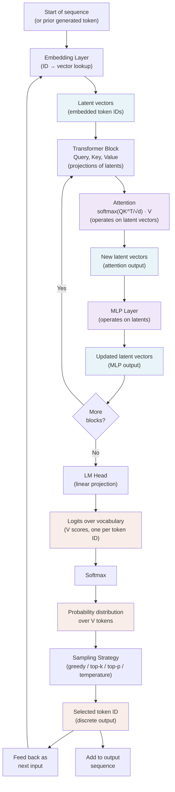

# Autoregressive Generation Cycle: Token IDs → Latent Space → Logits

This diagram illustrates the complete cycle of token generation in transformer-based LLMs, emphasizing that:
- **Token IDs** (integers) are the discrete outputs generated at each step
- **Latent vectors** (embeddings) are the continuous representations that flow through the transformer
- **Attention and MLPs** operate entirely in latent space
- The model generates discrete tokens autoregressively by sampling from logits, which are computed from latent representations

## Key Points

| Component | Input | Output | Space |
|-----------|-------|--------|-------|
| Embedding | Token ID (integer) | Latent vector | Continuous |
| Attention | Latent vectors | Latent vectors | Continuous |
| MLP | Latent vectors | Latent vectors | Continuous |
| LM Head | Latent vectors | Logits | Continuous |
| Sampling | Logits (probabilities) | Token ID (integer) | Discrete |

**The token ID is the only discrete object.** Everything else—embeddings, attention weights, layer norm, MLP outputs, logits—is continuous and lives in latent space. Attention never sees token IDs; it only sees and combines embedded latent vectors based on their similarity in that space.

The feedback loop closes when a newly sampled token ID is embedded and fed back as input to the next forward pass.
