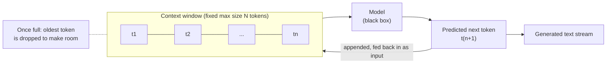
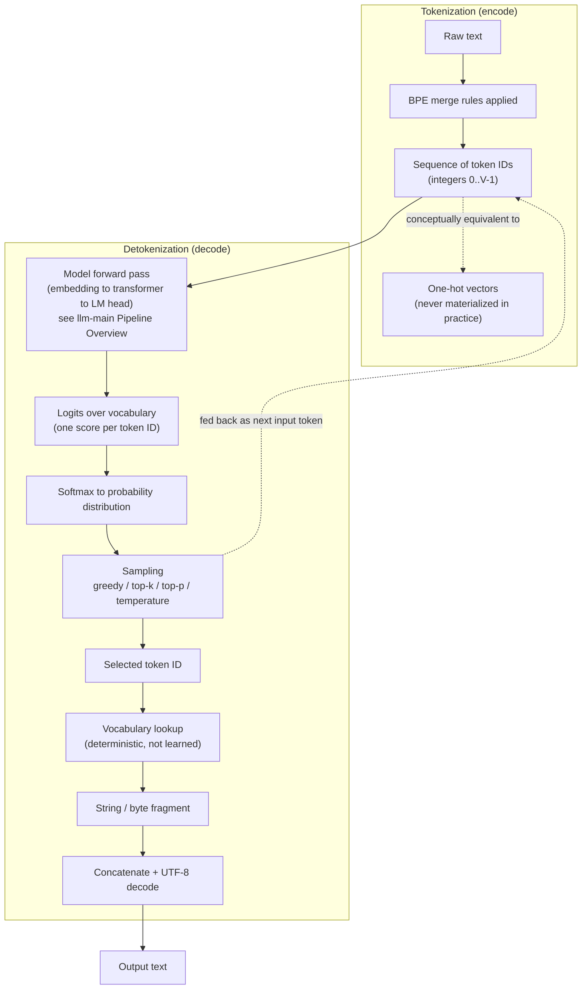

# Data Preparation and Tokenization

## Pretraining Data Collection and Filtering

The starting point is a raw internet crawl (e.g. Common Crawl) - a huge, noisy dump of HTML pages accumulated over years of web crawling. This raw crawl is not used directly; it goes through a multi-stage filtering pipeline (the general recipe popularised by datasets such as FineWeb) before it is fit to train on:

- **URL/domain filtering** - blocklists remove spam, malware, adult content, and other undesirable domains before any page content is even fetched.
- **Text extraction** - HTML markup, navigation, boilerplate, and ads are stripped out, leaving the underlying natural-language text of each page.
- **Language filtering** - a language classifier keeps only documents above some confidence threshold for the target language(s) (e.g. English).
- **Deduplication** - near-duplicate and exact-duplicate documents are removed so the same content isn't massively overrepresented.
- **PII removal** - addresses, phone numbers, and other personally identifiable information are scrubbed.
- **Quality filtering** - heuristics and/or learned classifiers discard low-quality text (e.g. keyword-stuffed pages, gibberish, malformed text).
- **Benchmark decontamination** - text matching known evaluation-benchmark documents is stripped out, to avoid train/test contamination inflating downstream scores (see [[evaluation_paradigms]]).

The result is a much smaller, much higher-quality dataset (on the order of tens of TB of text, translating to trillions of tokens) - this is what pretraining actually consumes. The filtered documents are concatenated together with special document-boundary tokens inserted between them, forming the long token stream the model is trained on.

### Data Mixture, Upsampling, and Epochs

> [!note] Data mixture, upsampling, and epochs
> The final training set isn't just filtered Common Crawl at its natural proportions: higher-quality sources (Wikipedia, books, code, curated reference text) are typically **upsampled** - repeated at a higher rate than their natural frequency in the raw crawl - because their information density is worth more than their scarcity would otherwise imply. Despite the dataset's enormous size, pretraining generally only passes over it a handful of **epochs** (often less than one full pass, or just a few) - unlike classical small-dataset deep learning, where many epochs over the same data is normal.

## Autoregressive Generation and the Context Window

At a high level (leaving attention/transformer mechanics for [[architecture]]): an LLM generates text one token at a time. At each step, the model looks at all tokens produced so far and predicts the next one; that token is appended to the sequence and fed back in as input for the next step. This is what "autoregressive" means.

The model can only condition on a fixed maximum number of preceding tokens at once - its **context window**. Anything outside that window is invisible to the model. Since the context window is a budget measured in *tokens*, not characters or words, how much real text fits into it depends entirely on how densely the tokenizer packs that text - which is the direct motivation for tokenization below.

## Tokenization

### Choosing a Tokenization Granularity

Tokenization granularity is a spectrum, bounded by two extremes that are both undesirable:

- **Character/byte-level** (one extreme): a tiny, fixed vocabulary (e.g. 256 for raw bytes), but it makes sequences very long. Since attention cost grows with sequence length, this is both computationally expensive and wastes the model's finite context window on a very low information-density representation.
- **Word-level** (the other extreme): short sequences, but an unbounded, effectively-infinite vocabulary - words can't be fully enumerated (new words, typos, names, and morphological variants like "run"/"running"/"runner" each demanding their own slot). This inevitably produces out-of-vocabulary words, historically handled by mapping anything unseen to a generic `<UNK>` token that discards information.

Tokenization compresses text into a shorter sequence of larger, denser units before it ever reaches the model - but the goal is to land somewhere between these two extremes, not at either one.

### Byte-Pair Encoding (BPE)

BPE is exactly this middle ground, and it's *learned* from data rather than fixed in advance: starting from individual bytes, the most frequent adjacent pair of tokens in the training corpus is repeatedly merged into a new single token, until a target vocabulary size is reached (e.g. GPT-2 uses on the order of 100K tokens). The resulting vocabulary mixes single characters, common sub-words, and whole common words - frequent words end up as single tokens (word-level efficiency where it's cheap), while rare or unseen words decompose into smaller sub-word or byte pieces (character-level robustness where it's needed, and exactly why BPE never needs an `<UNK>` token - see the byte-level fallback note below). Once trained, the tokenizer maps any input text into a sequence of these tokens - the token, not the character or the word, is the atomic unit the LLM actually sees and predicts over.

### Tokenizer Training Is Separate From Model Training

> [!note] Tokenizer training is separate from model training
> The tokenizer is trained once, up front, on a sample of the corpus - before the model itself is ever trained. Its training algorithm is the frequency-counting BPE merge procedure above, not gradient descent, and it produces a fixed vocabulary/merge-rule table that is then frozen for the rest of pretraining, fine-tuning, and inference. It's easy to conflate "training the tokenizer" with "training the model," but they're two separate procedures with separate objectives.

### Byte-Level Fallback (No Unknown Tokens)

> [!note] Byte-level fallback (no unknown tokens)
> Because BPE here operates over raw bytes rather than whole characters or words, any input - rare unicode, emoji, typos, code, other languages - can always be tokenized: when no merge rule applies, the tokenizer falls back to individual bytes. This guarantees there is never an "unknown token" / out-of-vocabulary problem, which was a real limitation of older word-level tokenizers that had to map anything unseen to a generic `<UNK>` token.

### Special Tokens

> [!note] Special tokens
> Beyond the merge-derived vocabulary, the tokenizer reserves a small set of **special tokens** that are never produced by merges but inserted structurally - e.g. `<|endoftext|>` as the document-boundary token mentioned above, marking where one training document ends and the next begins. The same mechanism is reused later, at the fine-tuning stage, for chat-turn delimiter tokens (e.g. `<|im_start|>` / `<|im_end|>`) that structure a conversation into turns - see [[training_and_adaptation]].

### Vocabulary Size Tradeoff

> [!note] Vocabulary size tradeoff
> Vocabulary size is a real design knob, not an arbitrary hyperparameter. A **larger vocabulary** packs more text per token, giving shorter sequences (cheaper attention, more effective context per token) - but it enlarges the embedding matrix and the LM head, and makes the final softmax over the vocabulary more expensive. A **smaller vocabulary** has the opposite tradeoff: cheaper embedding/LM-head matrices, but longer sequences for the same text.

### Sampling Strategies

> [!note] Sampling strategies
> Once the LM head produces logits over the vocabulary and they're softmaxed into a probability distribution, a **sampling strategy** decides which single token ID is actually selected at that step:
>
> - **Greedy decoding** - always take the argmax (highest-probability token). Deterministic, but prone to repetitive/degenerate output over long generations.
> - **Temperature** - rescale the logits by dividing by $T$ before the softmax. $T < 1$ sharpens the distribution toward the top tokens (more deterministic, closer to greedy as $T \to 0$); $T > 1$ flattens it (more diverse, more random); $T = 1$ leaves the distribution unmodified.
> - **Top-k sampling** - restrict the sampling pool to the $k$ highest-probability tokens, renormalize their probabilities, then sample from that reduced pool.
> - **Top-p / nucleus sampling** - restrict the pool to the smallest set of tokens whose cumulative probability exceeds $p$, renormalize, then sample. Unlike top-k's fixed pool size, this adapts the pool size to how peaked or flat the distribution is at each step.
>
> These are typically combined in practice (e.g. temperature + top-p together). The general tradeoff: more deterministic settings (greedy, low temperature) give more coherent but more repetitive text; more stochastic settings (high temperature, top-p) give more diverse but more error-prone text.

### Detokenization

Detokenization is the deterministic inverse of the tokenizer's vocabulary table - no learned component is involved here, unlike the embedding lookup on the model's input side. At each generation step the model produces logits over the vocabulary, which are softmaxed into a probability distribution; a sampling strategy (greedy, temperature, top-k, top-p) selects one token ID from that distribution. That ID is looked up in the vocabulary to recover its underlying string/byte fragment, and consecutive fragments are concatenated and decoded as UTF-8 to produce the visible text stream. The selected token is also fed back in as input for the next generation step (see [[llm-main]] for how this fits into the full pipeline).

### Encode/Decode Pipeline (Detailed)

Higher-resolution view of tokenization (encode) and detokenization (decode), including the one-hot equivalence and the encode/decode asymmetry (encode uses BPE's merge rules; decode is a plain lookup):

### Tokenization-Induced Quirks

> [!warning] Tokenization-induced quirks
> Several otherwise-puzzling LLM behaviours trace directly back to tokenization rather than to reasoning ability:
>
> - **Poor spelling / character-level tasks** (e.g. counting the letters in "strawberry") - the model never sees individual characters, only whole-token chunks, so tasks that require reasoning below the token granularity are inherently harder for it.
> - **Weak multi-digit arithmetic** - numbers are chunked into tokens inconsistently (e.g. digit groupings vary by number and by context), so the model doesn't have a stable positional/place-value representation of digits the way it would if trained on individual digit characters. Concrete example: GPT-2's tokenizer chunks digit sequences inconsistently (arbitrary groupings depending on the surrounding text), while GPT-4's tokenizer was deliberately designed to group digits into fixed chunks of 3, giving the model a more consistent representation of numbers and measurably improving its arithmetic.
> - **Non-English token inefficiency** - languages other than the tokenizer's dominant training language often require more tokens per word, which effectively shrinks the usable context window and raises inference cost for those languages.
> - **Whitespace/boundary artifacts** - how leading/trailing whitespace attaches to tokens can shift tokenization in ways that affect model behaviour on superficially identical prompts.

### Inspecting Tokenization

> [!tip] Inspecting tokenization
> Tools such as `tiktoken` (and interactive tokenizer visualizers) let you directly inspect how a given tokenizer splits arbitrary text into tokens - a useful way to build intuition for why the model "sees" text the way it does, and to debug the quirks above.
